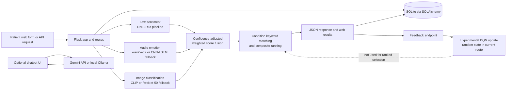

# Naxerion AI — SEDRS

**Sentiment-Enhanced Drug Recommendation System (SEDRS)**<br>
*An evidence-oriented multimodal AI research prototype combining sentiment analysis, a rule-based recommendation engine, and an experimental DQN feedback loop.*

[](https://www.python.org/)
[](https://pytorch.org/)
[](https://flask.palletsprojects.com/)
[](./LICENSE)

**Status:** Academic research prototype; not clinically validated or production-ready.<br>
**Repository:** [abhilashpuli98/NaxerionAI-Hybrid-Sentiment-Enhanced-Drug-Recommendation-System-using-DQN-Reinforcement-Learning](https://github.com/abhilashpuli98/NaxerionAI-Hybrid-Sentiment-Enhanced-Drug-Recommendation-System-using-DQN-Reinforcement-Learning)<br>
**Architecture source:** [architecture_diagram.html](./architecture_diagram.html)
**Demo and supplementary materials:** [Google Drive folder](https://drive.google.com/drive/folders/1j7exQ2YZmYHIo7UcMOX03KDRtBjz59M8?usp=drive_link)

> **Medical safety:** This project is an academic research prototype. It is not a substitute for professional medical advice, clinical evaluation, or licensed healthcare decision-making. Do not use its output to select, prescribe, or change medication. Model predictions require independent validation before any real-world clinical use.

## Overview

Medication choice depends on clinical context that is not represented by a drug name or a single sentiment label. Patient feedback may arrive as text, speech, or an image, and those signals can describe different aspects of an experience. SEDRS explores a pipeline that analyzes these inputs, combines modality-level outputs, and ranks a small catalog of medications using condition keywords and hand-authored scores. A separate DQN module experiments with feedback-driven updates.

The project is useful as an integration and research prototype, not as evidence of clinical benefit. In the current implementation, the DQN is **not** the policy that produces the web application's ranked recommendations, and the repository does not establish improved health outcomes.

## Architecture

The flow below summarizes the implemented Python application. It separates the recommendation path from the experimental DQN update path and from the standalone Naxerion chat interfaces.



### Component-to-source map

| Architecture component | Implementation | Responsibility and evidence |
|---|---|---|
| Application entry points | [`run.py`](./run.py), [`app.py`](./app.py) | `run.py` starts the loopback Flask development server; `create_app()` configures Flask, SQLite, blueprints, and tables. |
| Text processing | [`text_sentiment.py`](./text_sentiment.py) | Hugging Face `cardiffnlp/twitter-roberta-base-sentiment` pipeline, returning negative/neutral/positive classes and confidence. The `BERT_MODEL` setting in `config.py` does not select this pipeline. |
| Audio processing | [`audio_processing.py`](./audio_processing.py) | Hugging Face wav2vec2 emotion-classification model with a second model fallback; if both fail, MFCC features feed the local CNN+LSTM architecture. Without trained local weights, that fallback uses random initialization. |
| Image processing | [`image_processing.py`](./image_processing.py) | CLIP zero-shot classification into valid/uncertain/invalid image labels; fallback uses ImageNet ResNet-50 labels and keyword matching. This is not a verified pill-identification or expiry-detection system. |
| Multimodal fusion | [`fusion.py`](./fusion.py) | `MultiModalFusion` maps audio emotion labels to a three-level sentiment scale, adjusts modality weights using confidence and prior weights, then computes a weighted scalar score and confidence. |
| Recommendation ranking | [`recommendation_engine.py`](./recommendation_engine.py) | Hand-authored condition-keyword/category mapping, catalog ratings, sentiment/confidence terms, and a category relevance bonus. No learned DQN action scores are used here. |
| DQN | [`dqn_rl.py`](./dqn_rl.py) | Q-network, target network, replay buffer, epsilon-greedy selection, synthetic episode environment, and TD updates. |
| Request orchestration | [`main_system.py`](./main_system.py) | Loads modality analyzers and fusion/recommendation components; `full_pipeline()` analyzes, ranks, and assembles a report. |
| Flask API | [`api_routes.py`](./api_routes.py) | Health, patient, analysis, interaction, feedback, history, metrics, audit, and Ollama chatbot endpoints. |
| Web UI and session flow | [`web_routes.py`](./web_routes.py), [`templates/`](./templates), [`static/`](./static) | Registration/login, patient dashboard/profile, analysis/results, feedback, history, and admin pages. |
| Persistence | [`models.py`](./models.py), [`extensions.py`](./extensions.py) | SQLAlchemy entities for patients, interactions, recommendations, system metrics, user feedback, and audit logs. The default local database is SQLite under `instance/`. |
| Questionnaire chatbot | [`chatbot.py`](./chatbot.py) | In-memory questionnaire and keyword-based feedback categorization; this is not an LLM or a retrieval system. |
| Online Naxerion UI | [`Naxerion - AI-Online/`](<./Naxerion - AI-Online/>) | Browser UI that calls Gemini services and uses Firebase client libraries. API credentials are entered locally in the browser; never commit them. |
| Offline Naxerion experiments | [`Naxerion-AI-Offline/`](./Naxerion-AI-Offline/) | Separate Ollama/Gradio and FastAPI chat prototypes plus an offline frontend. They are distinct from the SEDRS recommendation models. |

### Request and feedback lifecycle

1. A user reaches the Flask web interface or sends a multipart request to `POST /api/analyze`.
2. The API resolves the patient record and condition, saves optional uploaded audio/image files, and calls `SEDRSystem.full_pipeline()`.
3. Each supplied modality is classified independently. The current orchestration supplies default class/confidence values for omitted or falsey modality outputs, so absent modalities and class `0` values can affect fusion; treat these outputs cautiously.
4. `MultiModalFusion` maps emotion to a sentiment ordinal and combines the three scores with confidence-adjusted weights.
5. `RecommendationEngine` matches condition keywords to categories and ranks candidate entries using static base ratings, a sentiment term, a confidence term, and a relevance bonus.
6. The API persists the interaction and its ranked recommendations and returns a JSON response. The web routes render results from those records.
7. `POST /api/recommendations/<id>/feedback` stores a rating, effectiveness label, and adverse-effects text. It then invokes the DQN with a newly generated random state, the drug ID as the action, the rating scaled to `[0, 1]`, and the same state as the next state. This is not the stored patient state and is not wired back into recommendation ranking.

### What the original architecture HTML does and does not establish

The linked HTML is preserved as the project's original high-level architecture illustration. Its labels include PostgreSQL, HIPAA compliance, encryption, Docker/cloud scalability, and continuous policy adaptation; those claims are **not verified by the checked-in Python implementation**. The application code configures SQLite and does not demonstrate a HIPAA assessment, deployment infrastructure, or those security controls. The Mermaid flow above is a code-grounded reading of the current source, not a replacement for the preserved HTML. GitHub renders the Mermaid preview directly; the HTML itself loads Mermaid from a CDN and is best opened in a browser with network access.

## Models and methodology

### Text sentiment

`TextSentimentAnalyzer` calls a pretrained Hugging Face sentiment pipeline using `cardiffnlp/twitter-roberta-base-sentiment`; its output labels map to indices `0=negative`, `1=neutral`, and `2=positive`. The module does not implement BERT fine-tuning, and its `save_model()` / `load_model()` methods are no-ops.

### Audio emotion

`AudioEmotionAnalyzer` first attempts `ehcalabres/wav2vec2-lg-xlsr-en-speech-emotion-recognition`, then `Dpngtm/wav2vec2-emotion-recognition`. If neither loads, it extracts MFCC features and runs `CNNLSTMEmotionClassifier`. That fallback can load `models/audio_model.pth`, but the main project contains no such trained checkpoint; absent weights are random. No speech-to-text implementation was found.

### Image analysis

`ImageDrugAnalyzer` uses `openai/clip-vit-base-patch32` with three text prompts. Its fallback classifies with ImageNet-pretrained ResNet-50 and keyword matching. Neither method establishes medication identity, authenticity, dosage, or expiration date; do not treat its class as a safety check.

### Fusion

The active `MultiModalFusion` uses prior weights (`0.40` text, `0.35` audio, `0.25` image) scaled by each modality's confidence and normalized. It maps audio emotion categories to negative/neutral/positive ordinals and combines those with the text and image class indices. This is weighted score fusion, **not learned cross-attention**. `AdvancedFusion` contains additional concatenation/attention-like methods but is not called by `SEDRSystem.full_pipeline()`; it should not be described as the active fusion path.

### Recommendation engine and DQN

The recommendation engine includes a static catalog, keyword-to-category rules, hand-entered base ratings and side-effect text, and a composite score:

- normalized base rating weighted by `0.6`;
- sentiment contribution up to `0.3`;
- confidence contribution up to `0.2`;
- a `0.15` category-match bonus.

These are heuristic values in source code, not validated pharmacological scores.

The experimental DQN has a 256-element input, 67 output actions, three hidden fully connected layers (`256 → 256 → 128`) with ReLU and dropout, a separate target network, Adam optimization, MSE TD loss, gradient clipping, replay memory (capacity 1,000), and epsilon-greedy action selection. The configured default replay batch is 32; the feedback route requests 16. The target network is synchronized every 10 simulated episodes, and epsilon decays after episodes.

`train_episode()` simulates transitions and computes rewards from state elements, action diversity, and random perturbations; it is not trained in a real clinical environment. The feedback endpoint uses random state rather than a saved multimodal state. The DQN's actions do not rank the recommendations returned by the web pipeline. The interaction table has fields for multimodal confidence and RL state, but the current analysis route does not populate them.

### LLMs, fine-tuning, retrieval, and speech

- **Online UI:** The static Naxerion browser app calls Gemini APIs directly for chat, image generation, and speech output, and loads Firebase Auth/Firestore client libraries. Its research mode passes Gemini's Google Search tool and can render returned grounding attributions; retrieval is provided by the external API, not by a repository-managed corpus or retriever. The UI requires user-supplied configuration and is not a backend-protected service.
- **Flask/Ollama integration:** The SEDRS API includes Ollama-backed chatbot endpoints and an SSE response path. A local Ollama service and a compatible downloaded model are required.
- **Offline prototypes:** `Naxerion-AI-Offline/backend/main.py` exposes FastAPI `/health`, `/chat`, and `/chat/stream` endpoints. `app.py` is a separate Gradio/Ollama chat. The included frontend also references a local `/tts` service that is not implemented in that FastAPI file; the end-to-end TTS path is therefore not verified.
- **RAG:** No local/indexed corpus, vector store, or repository-owned retrieval pipeline was found. The online UI does use Gemini's external Google Search grounding capability in research mode; this is not evidence of an implemented local RAG system.
- **SFT, instruction tuning, DPO, self-distillation:** No training scripts, dataset pipelines, or reproducible checkpoints implementing these procedures were found. `report.txt` describes such work, but it is narrative material and is not backed by executable training/evaluation artifacts. These techniques are not claimed as implemented here.
- **TTS/STT:** Gemini-based audio generation is present in the online UI. The project does not contain a verified speech-to-text pipeline; local Piper-related binaries do not, on their own, establish an integrated TTS implementation.

## Technology stack

| Area | Verified technologies |
|---|---|
| Language | Python 3.11.9 in the inspected local environment; JavaScript, HTML, CSS |
| Deep learning | PyTorch, TorchVision |
| NLP/audio/vision | Hugging Face Transformers; LibROSA, SoundFile, Pillow |
| Reinforcement learning | Custom PyTorch DQN and replay buffer |
| Backend/API | Flask, Flask-CORS, Flask-SQLAlchemy; optional FastAPI/Gradio/Ollama prototypes |
| Frontend | Jinja templates, static JavaScript/CSS; standalone Naxerion browser UIs |
| Database | SQLite via SQLAlchemy by default |
| Evaluation/tooling | `unittest` integration script, app smoke test, NumPy/pandas/scikit-learn, Matplotlib/Seaborn |
| Model hosting | Hugging Face Hub downloads on first use; Gemini APIs and Firebase for the online chat UI; local Ollama for offline chat |

`requirements.txt` lists flexible minimum versions for the main Flask/ML application. It does not declare a Python version and does not include every optional component used by secondary features (for example Flask-Login, FPDF, FastAPI, Gradio, or Ollama). No dependency lock file is present. The root requirements file is not a complete environment specification for the standalone chat prototypes.

## Project structure

```text
.
├── app.py, run.py                 # Flask factory and development entry point
├── api_routes.py, web_routes.py   # JSON API and server-rendered web routes
├── models.py, extensions.py       # ORM entities and shared SQLAlchemy extension
├── main_system.py                 # SEDRS pipeline orchestration
├── text_sentiment.py              # Text model adapter
├── audio_processing.py            # Audio model adapter and CNN-LSTM fallback
├── image_processing.py            # CLIP / ResNet image classification
├── fusion.py                      # Score fusion
├── recommendation_engine.py       # Rule-based catalog and ranking
├── dqn_rl.py                      # Experimental DQN
├── templates/, static/            # Flask UI
├── Naxerion - AI-Online/          # Gemini/Firebase browser application
├── Naxerion-AI-Offline/           # Separate local chat prototypes and UI
├── architecture_diagram.html      # Original high-level diagram
├── .env.example                   # Safe local configuration template
├── .gitignore                     # Excludes local/private and generated artifacts
├── requirements.txt               # Main app dependencies
├── test_integration.py            # 20-case unittest integration suite
├── test_app.py                    # Flask/database smoke check
└── Verification/verify_setup.py   # Database/app setup check
```

Runtime databases, uploaded files, model downloads, virtual environments, caches, logs, synthetic plots, and generated reports are intentionally not part of the source tree published from this working copy.

## Setup (Windows PowerShell)

The local environment inspected for this release uses Python 3.11.9. The project does not formally constrain supported Python versions; this is the version actually validated here.

```powershell
git clone https://github.com/abhilashpuli98/NaxerionAI-Hybrid-Sentiment-Enhanced-Drug-Recommendation-System-using-DQN-Reinforcement-Learning.git
Set-Location .\NaxerionAI-Hybrid-Sentiment-Enhanced-Drug-Recommendation-System-using-DQN-Reinforcement-Learning

python -m venv .venv
.\.venv\Scripts\Activate.ps1
python -m pip install -r requirements.txt
Copy-Item .env.example .env
```

If PowerShell blocks activation, allow it for the current process only:

```powershell
Set-ExecutionPolicy -Scope Process -ExecutionPolicy Bypass
.\.venv\Scripts\Activate.ps1
```

Edit `.env` locally and replace the `SECRET_KEY` placeholder with a random value. `.env` is ignored by Git; do not commit credentials. The app creates its SQLite schema when the Flask application is initialized. Text/audio/image models may download from Hugging Face on first use and require network access; the primary pipeline does not require a Gemini key.

Start the Flask application from the project root:

```powershell
python run.py
```

Open [http://127.0.0.1:5000](http://127.0.0.1:5000). `run.py` is the documented local-development entry point. The local `setup_and_run.bat` is not included in the release: besides installing/upgrading packages, it runs the non-reproducible plot generator.

## Usage and API

1. Register a local account and sign in through the web UI.
2. Open **Analyze** and submit a condition with optional synthetic text feedback, audio, or an image.
3. Review the modality outputs and heuristic ranking, then submit feedback if exercising the experimental feedback route.
4. The standalone Naxerion interfaces are available at `/naxerion/` and `/naxerion-offline/`; their external services are optional and require separate configuration.

Health check:

```powershell
curl.exe http://127.0.0.1:5000/api/health
```

The analysis endpoint is `POST /api/analyze` and accepts multipart form fields `patient_id`, `condition`, `text_input`, optional `top_k`, and optional audio/image uploads (`audio_file`/`audio_input`, `image_file`/`image_input`). It requires an existing local patient ID. Example with a local test account (do not use real patient information):

```powershell
$patientId = "REPLACE_WITH_LOCAL_TEST_ACCOUNT_ID"
curl.exe -X POST http://127.0.0.1:5000/api/analyze `
  -F "patient_id=$patientId" `
  -F "condition=pain" `
  -F "text_input=This is synthetic test feedback."
```

Other routes include `/api/patients`, `/api/interactions/<id>`, `/api/recommendations/<id>/feedback`, `/api/patients/<id>/history`, `/api/metrics`, `/api/audit-logs`, and `/api/chatbot`. API routes do not consistently enforce authentication/authorization. Keep the service bound to localhost and use synthetic data only; do not expose it to a network or submit real patient records.

The demo folder contains supplementary materials; it is not a live deployed application.

## Experimental results and evidence

Numbers previously appearing in draft reports, generated plots, and JSON summaries are not reproducible evaluation evidence. The plot generator explicitly creates simulated training curves and hard-coded confusion matrices/comparisons. Some summary figures are also hard-coded in test/report output. No dataset, dataset version, sample count/split, baseline protocol, or end-to-end evaluation harness substantiates the following claims:

| Proposed claim | Audit finding | README treatment |
|---|---|---|
| Cross-modal accuracy: 90% | Repeated in output summaries, but no reproducible multimodal benchmark or dataset split was found. | Not reported as a measured result. |
| End-to-end inference latency: below 1.5 s | No benchmark script or recorded measurement with hardware, warm/cold model state, and timing protocol was found. | Not claimed. |
| Recommendation accuracy improvement: 7% | No reproducible baseline experiment or metric definition was found. The plot generator hard-codes an example comparison and labels its result inconsistently. | Not claimed. |
| Reduction in adverse predictions: 12% | No experiment or calculation supporting this figure was found. | Not claimed. |
| Per-modality accuracy values in draft files | Values vary between documents and are not linked to evaluable predictions, labels, splits, or datasets. | Not claimed as validated metrics. |

The `TEXT_DATASET_SIZE`, `AUDIO_DATASET_SIZE`, and `IMAGE_DATASET_SIZE` constants are not evidence that those datasets are included or that an evaluation was run. Experimental values in `report.txt`, `.md/`, `results/`, and `ieee_plots/` are excluded from release because they are unsupported, synthetic, contradictory, or generated output.

## Testing and validation

Executed in the local Python 3.11.9 virtual environment:

| Check | Result |
|---|---|
| `python -m pip check` | Passed: no broken requirements reported. Pip emitted a warning about an invalid `~ip` distribution in the local environment. |
| `python test_integration.py` | Passed: 20 tests, 0 failures, 0 errors. One SQLAlchemy legacy API warning was emitted. |
| `python test_app.py` | Passed: app factory, SQLite table access, and a read-only query succeeded. The existing local database contains records and is not included in publication. |
| `python quick_test.py` | Not run in this validation. The script calls `TextSentimentAnalyzer.train()`, which is not implemented by the current class. An existing `test_results.log` also records its first test failing; its later “all components operational” summary is not reliable. |
| Model evaluation / clinical validation | Not demonstrated by the executed tests. |

The integration suite validates API/database/validator behavior; it does not load and benchmark all models or establish recommendation quality. Fresh environments may need network access and substantial downloads for pretrained models. The standalone Ollama, FastAPI, Gradio, and speech assets were not validated as a complete installation.

The legacy `quick_test.py` and `generate_ieee_plots.py` are not included in the release: the former calls a missing analyzer method and records synthetic metric summaries, while the latter generates simulated curves and hard-coded comparisons rather than plots from experiment outputs. `init_db_safe.py` is also excluded because it disables TLS certificate verification. `Verification/verify_system.py` expects a pre-existing runtime database and checks undeclared optional dependencies, so it is not included; `Verification/verify_setup.py` is retained as a narrower setup check. These local files have not been deleted or changed. `SEDRS_Showcase.html` is not linked or published because it presents unsupported clinical/security and performance claims.

## Limitations and responsible use

- Research prototype only; no clinical validation, regulatory assessment, or clinician workflow evaluation is established.
- The recommendation catalog, ratings, condition mapping, scoring weights, and side-effect descriptions are hand-authored examples, not a clinical knowledge base.
- Modality classes are reduced to ordinal scores, and the code's default/falsey handling can replace missing inputs or class-zero predictions with other values.
- The image model performs prompt-based image categorization, not medication identity, packaging verification, or expiry detection.
- The DQN uses simulated transitions for training and random state vectors in the feedback route; its policy is disconnected from the ranked recommendation results.
- Dataset provenance, labels, representativeness, evaluation splits, calibration, uncertainty handling, and generalization are not established.
- Model outputs may be biased, incomplete, or confidently wrong. Compute and first-use model downloads vary by hardware and network.
- The Flask API has routes without consistent authentication/authorization, broad CORS settings, and development-oriented defaults. It is not safe to deploy publicly as-is.
- The code stores demographic/medical form data, feedback, interactions, and uploads locally. The included working database and uploads are excluded because they may contain private information.

Do not use the project to make medical decisions. Any future clinical use would require qualified clinical oversight, privacy/security review, regulatory review where applicable, representative external validation, and a carefully governed deployment.

## Future work

- Build a reproducible evaluation pipeline with documented, licensed datasets, splits, baselines, metrics, and artifact provenance.
- Connect recommendation actions to a well-defined state/action mapping and evaluate the policy offline before considering prospective testing.
- Validate modality calibration and fusion behavior, including missing-input and class-zero cases.
- Add explicit dependency/environment specifications for optional chat components and test each supported workflow.
- Complete threat modeling, authentication/authorization, privacy controls, and clinical safety review before any deployment.

## License and acknowledgements

The repository is licensed under [Apache License 2.0](./LICENSE). Model checkpoints, pretrained model services, datasets, and bundled third-party executables have separate licenses and terms; they are not automatically covered by this project's license. This release does not redistribute the local databases, uploads, pretrained downloads, or unverified Naxerion/Piper model binaries.

The implementation uses third-party work including Hugging Face Transformers and models, PyTorch/TorchVision, LibROSA, CLIP, and other packages listed in `requirements.txt`. Refer to each upstream project/model card for its attribution and license before reuse.
